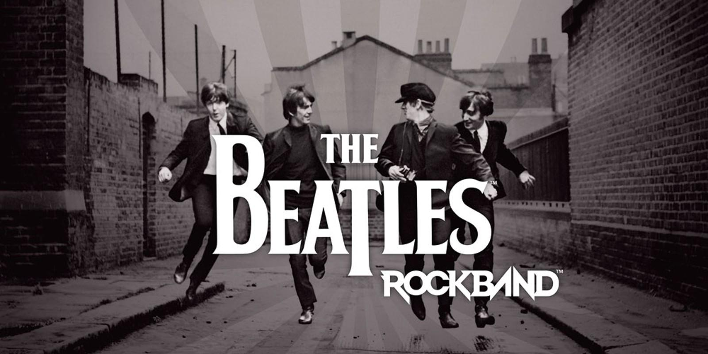

# Beatles Rock Band Launcher for Xbox Series X



A community launcher for playing your own Xbox 360 copy of **The Beatles: Rock Band** in Xbox Developer Mode, powered by a customized [Xenia UWP](https://github.com/danprice142/xenia-canary-uwp) build.

**Open the tile. The game starts.** Normal startup goes directly to your configured game copy. A recovery screen is available when files need attention. The Xbox Riffmaster is mapped automatically, including whammy and tilt.

**Status: experimental, first launcher release in testing.** Version 0.6.0.10 reached the game intro in three full quit-and-reopen checks on Series X, with no profile or Play selection. The underlying build has been played with one Xbox PDP Riffmaster. Final-build gameplay, story-save reload and account association still need verification before publication. This is an unofficial community project and still requires Developer Mode; it is not an official backward-compatible release or Microsoft Store product.

Version **0.6.0.11** passed its full Windows build, package/source audit and initial console startup, but Quick Play has a reported audio/note timing offset from the start of a song. Its draft release is held. Development source now targets **0.6.0.12** with [opt-in audio timing diagnostics](docs/AUDIO-DIAGNOSTICS.md); this is not yet a verified fix. Native console-account selection and migration also await save/reload verification. The account integration adds `userAccountInformation` permission for local save association; see the [verification guide](docs/NATIVE-ACCOUNT-TESTING.md). It does not provide Xbox Live authentication or cloud saves.

No game executables/data, music, charts, DLC, console keys, or firmware are included. Supply your own game dump obtained and used as permitted where you live. This project does not download games. The supplied promotional images in `artwork/` are separate from the code license; see [artwork notices](artwork/README.md).

## Start here

1. Enable Xbox Developer Mode and open Xbox Device Portal from a browser on your Mac or PC.
2. For a one-time default, enable **Device Portal → Settings → Preference → Treat UWP apps as games by default**, leave it on, and restart if prompted. An existing App assignment may need one final correction in Dev Home → launcher → **View** → **Details** → **App type: Game**. App mode does not provide the memory and input access this game needs.
3. Once a release is available, download its **x64 install bundle** from this project's **Releases**. Install its APPX through Device Portal with the included Microsoft x64 VCLibs dependency if needed. The separate, larger **corresponding-source.tar.gz** is optional code for inspecting or rebuilding; players do not need it.
4. Copy the complete extracted game folder to `D:/DevelopmentFiles/Games/xbox360/Beatles-Rock-Band`, keeping `default.xex` and the other files together. Alternatively, choose your game folder in the launcher's setup screen.
5. Connect the Xbox Riffmaster's USB receiver, turn on the guitar, and open **The Beatles: Rock Band**. The 0.6.0.11 candidate uses your signed-in console account to select a local save profile, with Xbox's native picker when needed. This still needs console verification. The earlier 0.6.0.10 draft creates an offline Player 1 automatically. If recovery is shown, select the correct game copy and **Play** with green/A. See [validation](docs/VALIDATION.md) for the remaining checks.
6. Use the game's calibration settings once for your TV and sound system. Controller mapping does not measure audio/video delay for you.

See the [step-by-step installation guide](docs/INSTALL.md), [instrument compatibility](docs/COMPATIBILITY.md), and [troubleshooting](docs/TROUBLESHOOTING.md).

## What this changes

- Direct launch with a remembered game location and title-ID validation.
- A recovery screen for missing files or multiple copies.
- Xbox Riffmaster fret/strum/Menu/View input plus native whammy and tilt readings.
- Stable player assignment and 150% default positive tilt gain, adjustable in local settings.
- An audio callback lifetime fix for a reproduced deadlock.
- A guitar-specific input-release fix: a resting whammy bar no longer needs to look like a centered thumbstick after a host dialog closes.
- Offline play and two shader-compiler workers by default. Existing local settings are preserved on update.

This build supports **one Xbox Riffmaster**. Independent second-guitar routing and microphone capture are not implemented yet. Drums, online play and DLC have not been verified. Native Series X account association is implemented in development version 0.6.0.11 but awaits console verification. It selects offline saves and does not provide Xbox Live sign-in. The launcher does not make legacy Xbox 360 USB instruments compatible with Series X.

## Build and source

All launcher/adapter changes and regression tests are in `xenia-patches/`. The build pins Xenia UWP to commit `2e03062001c27c1f20010bb397783c8d66c58041` and fetches the public Microsoft GameInput header at a pinned revision. GameInput itself is loaded from the Xbox operating system; its redistributable DLL is not bundled.

On Windows with Visual Studio 2022 C++ tools, Windows SDK, Git, CMake and Python:

```powershell
./xenia-patches/build-full.ps1
```

Or use **Actions → Build Xbox launcher → Run workflow** in your fork. Mac users can install a finished release through a browser; compiling the UWP package requires Windows, which GitHub Actions provides.

The build runs the instrument mapping, player-slot, tilt, audio-race, input-release, and game-file selection regressions before compiling the full emulator. A green build is not a substitute for console gameplay verification. See [validation](docs/VALIDATION.md) and [third-party notices](THIRD_PARTY_NOTICES.md).

## Credits

Built on the work of the [Xenia project](https://github.com/xenia-project/xenia), [Xenia Canary](https://github.com/xenia-canary/xenia-canary), and [DanP142's Xbox UWP port](https://github.com/danprice142/xenia-canary-uwp). Instrument research includes [RB4InstrumentMapper](https://github.com/TheNathannator/RB4InstrumentMapper) and [riffmaster-rgh360](https://github.com/Durg5/riffmaster-rgh360).

This project is not affiliated with or endorsed by Microsoft, Xbox, Harmonix, EA, PDP, or the Beatles rights holders. Product names identify the software and hardware involved; no endorsement is implied.
